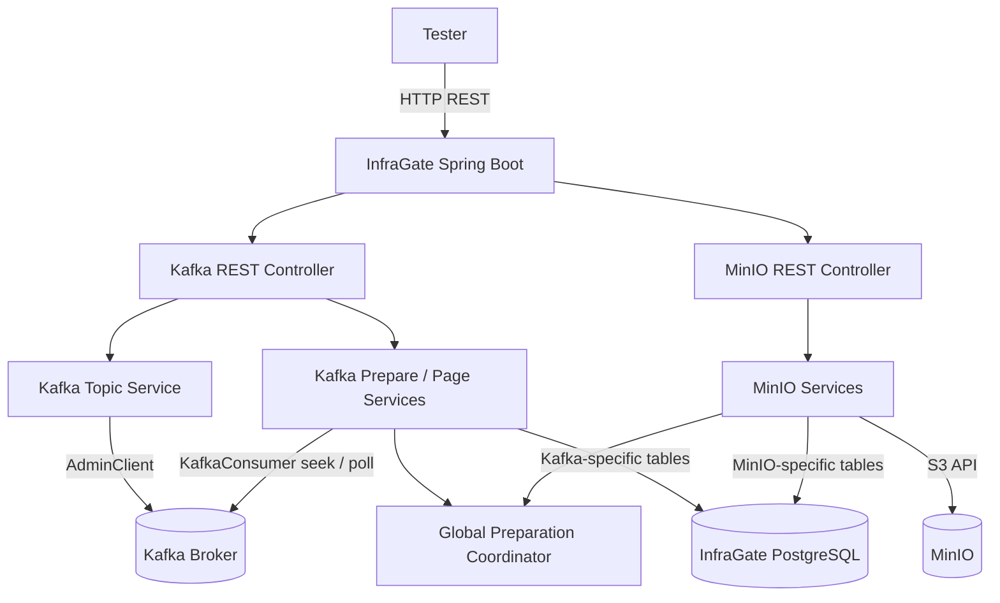
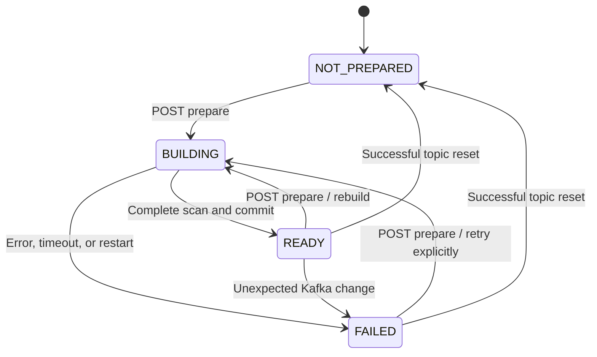

# InfraGate Kafka

[← CommerceETLAV Manager](https://github.com/orbartal/commerce-etlav-manager)

[← CommerceETLAV InfraGate](https://github.com/orbartal/commerce-etlav-infra-gateway)

InfraGate exposes a small, consistent REST interface for CommerceETLAV Tester. The Kafka adapter translates synchronous HTTP requests into Kafka administrative, inspection, and read operations. A background **prepare** task builds a PostgreSQL index so Tester can use conventional page indices rather than Kafka offsets or cursor APIs.

### Shared event-reading contract (approved MVP)

The [main InfraGate README](../README.md) defines the common API standard. Both adapters expose:

- `GET /events/summary/all?index=0&size=100` — ordered event ID strings, including Kafka duplicates.
- `GET /events/details/eventid/{eventId}?index=0&size=10` — paginated normalized full events matching `eventId`.
- Both endpoints require `READY`. Both use `index >= 0`, `1 <= size <= 1000`, `totalCount`, `responseCount`, and `items`.
- `totalCount` is the total matching index rows; `responseCount = items.length`. Missing event IDs return `404 EVENT_NOT_FOUND`.
- Each details item has four top-level fields: `eventId`, `datasetId`, `payload`, `metadata`.
- `payload` is the original Generator event payload. `metadata.kafka` or `metadata.minio` holds adapter-specific data.
- Kafka duplicate `eventId` values are allowed. Duplicate payloads are assumed identical in MVP.
- Only one global Kafka-or-MinIO preparation may run at once. A competing request returns `409 PREPARATION_ALREADY_RUNNING`.
- Invalid JSON or missing/invalid `eventId` or `datasetId` fails preparation. Incomplete indexes are never readable.
- Tester owns the authoritative first E2E scenario; adapter-specific sequences here are summaries.

## Table of Contents

1. [Context and Goals](#1-context-and-goals)
2. [MVP Scope and Future Vision](#2-mvp-scope-and-future-vision)
3. [Technology Stack](#3-technology-stack)
4. [Architecture and Components](#4-architecture-and-components)
5. [Kafka Topic Management](#5-kafka-topic-management)
6. [Kafka Message Inspection](#6-kafka-message-inspection)
7. [Topic Preparation and Lifecycle](#7-topic-preparation-and-lifecycle)
8. [PostgreSQL Data Model](#8-postgresql-data-model)
9. [Kafka Message Pagination](#9-kafka-message-pagination)
10. [Kafka REST API](#10-kafka-rest-api)
11. [Error Handling and Validation](#11-error-handling-and-validation)
12. [Configuration and Timeouts](#12-configuration-and-timeouts)
13. [Logging and Recovery](#13-logging-and-recovery)
14. [Development and Deployment](#14-development-and-deployment)
15. [Future Extensions](#15-future-extensions)
16. [References](#16-references)
17. [Tester Integration — First MVP Test](#17-tester-integration--first-mvp-test)

## Table of Diagrams

| ID | Diagram | Section |
|---|---|---|
| D1 | Unified InfraGate component architecture | [4.2](#42-component-diagram) |
| D2 | Kafka preparation lifecycle | [7.7](#77-preparation-lifecycle-diagram) |
| D3 | First Tester scenario sequence | [17.7](#177-end-to-end-sequence-diagram) |

## Table of Tables

| ID | Table | Section |
|---|---|---|
| T1 | MVP and future capabilities | [2.2](#22-capability-matrix) |
| T2 | Technology stack | [3](#3-technology-stack) |
| T3 | Topic and index states | [7.3](#73-status-contract) |
| T4 | SQL schema | [8](#8-postgresql-data-model) |
| T5 | REST endpoint summary | [10.1](#101-endpoint-summary) |
| T6 | HTTP errors | [11.2](#112-error-catalog) |
| T7 | Configuration | [12.1](#121-configuration-properties) |
| T8 | Tester scenario API calls | [17.5](#175-tester-api-call-summary) |

---

## 1. Context and Goals

### 1.1 CommerceETLAV event flow

The first MVP scenario exercises the path **Tester → Generator → Kafka → Ingestor → MinIO**. Generator produces events for a predefined scenario and `datasetId`; Ingestor consumes those Kafka events and persists their original JSON envelopes in MinIO. Tester verifies the results through InfraGate, not by embedding Kafka or S3 clients.

A Generator scenario has a fixed dataset UUID discoverable through `GET /api/v1/scenarios/{scenarioId}`. The same event should be identifiable in Kafka and MinIO, although the two adapters maintain separate indexing and storage logic.

### 1.2 InfraGate responsibility

- Provide simple, standard, synchronous HTTP request/response APIs to Tester.
- Hide Kafka `AdminClient`, `KafkaConsumer`, partition offsets, seeking, and other infrastructure details.
- Prepare a stable view of completed Kafka test data in the background, then offer exact index/size paging.
- Keep complete Kafka message data in Kafka; PostgreSQL stores only message locators and preparation metadata.
- Reject unexpected changes to prepared data rather than returning incomplete or misleading results.
- Keep Kafka and MinIO adapter code and tables isolated while deploying them in **one InfraGate microservice**.

### 1.3 Non-goals

InfraGate is not a production event API, a Kafka broker, a replacement consumer, a Kafka REST Proxy, or a source of business truth. It does not produce test events, own Ingestor's consumer group, or manage test orchestration. Tester manages waits, retries, assertions, and the final test outcome.

## 2. MVP Scope and Future Vision

### 2.1 MVP assumptions

- One local Kafka broker and one target topic with **exactly one partition**.
- One Tester task executes at a time; only Tester calls InfraGate APIs.
- Tester stops Generator and Ingestor before preparing/validating the topic; no new messages arrive and no records are deleted during this phase.
- Kafka retention is configured so test messages remain available for the entire test.
- One global background preparation operation across **both Kafka and MinIO** at any moment.
- Full indexing: every readable Kafka message has one PostgreSQL row containing its position, `eventId`, and locator.
- No Kafka cursor APIs, no external Kafka Bridge, no DB copy of message payloads.

### 2.2 Capability matrix

| Capability | MVP | Future |
|---|---|---|
| Topic partition count | One | Multiple partitions with deterministic global ordering |
| Preparation | One background job globally | Scalable job scheduling if needed |
| SQL index | Every message offset | Sparse checkpoints (e.g., every 100 or 1,000 messages) |
| Paging | Zero-based index and size | Same REST contract with sparse seek/read logic |
| Message body | Read directly from Kafka | Same; optionally other validation strategies |
| Storage | Shared InfraGate PostgreSQL | Independent scaling/storage if required |
| Change detection | Offset boundaries plus exact-message verification | Stronger snapshot/epoch validation if needed |

## 3. Technology Stack

| Layer | Choice | Purpose |
|---|---|---|
| Language | Java 27 | Service implementation |
| Framework | Spring Boot 4 | REST, configuration, lifecycle |
| Build | Maven | Dependency management and packaging |
| Kafka client | Apache Kafka Java AdminClient and KafkaConsumer | Topic operations and message retrieval |
| Persistence | PostgreSQL, dedicated Docker container | Prepared message locators and state |
| SQL access | Spring JDBC or equivalent lightweight SQL access | Explicit transactions and efficient batch writes |
| REST documentation | Springdoc/OpenAPI compatible with chosen Spring Boot version | Swagger API documentation |
| Runtime | Docker Compose | Local CommerceETLAV environment |

**Note:** Kafka and MinIO use one InfraGate application and one PostgreSQL instance, but separate tables, adapters, and data-access code. The MinIO adapter uses AWS SDK for Java v2 S3 client as specified in its own document.

## 4. Architecture and Components

### 4.1 Component boundaries

1. **Kafka REST controller:** Validates HTTP inputs and maps errors to the public contract.
2. **Kafka topic service:** Reads metadata, checks emptiness, and resets topic records.
3. **Kafka preparation service:** Schedules one background preparation, scans messages, and updates SQL state.
4. **Kafka pagination service:** Queries SQL locators by position or `eventId` and fetches matching messages by Kafka offset.
5. **Kafka repositories:** Own Kafka-specific SQL state and message-locator rows.
6. **Global preparation coordinator:** Enforces a single active Kafka-or-MinIO preparation across the application.
7. **MinIO adapter:** Independent service logic sharing only application infrastructure and agreed API conventions.

### 4.2 Component diagram



### 4.3 Synchronous versus asynchronous behavior

All HTTP endpoints are ordinary synchronous REST calls. `POST /prepare` **starts** a background task and responds immediately with `202 Accepted`; it does not hold the HTTP request open until indexing completes. `GET /status` is synchronous and supports Tester's non-blocking polling workflow. Other Kafka operations (including reset and page reads) complete within their own configurable request timeouts.

## 5. Kafka Topic Management

### 5.1 Topic details

`GET /topics/{topic}/details` returns topic name, partition count, and the current beginning/end offsets for each partition. The MVP requires exactly one partition for preparation and paging; topic details can still reveal the actual partition count.

Kafka offsets are positions in a partition, **not** sequential event counts. They may have gaps, and retention/deletion can move the beginning offset.

### 5.2 Empty check

`GET /topics/{topic}/empty` returns `empty=true` when the beginning offset equals the end offset for every partition. It checks **currently readable records**, not whether the topic has ever received records. No SQL preparation is required.

### 5.3 Topic reset

`POST /topics/{topic}/reset` uses `AdminClient.deleteRecords()` to remove existing readable records up to the captured end offset. InfraGate waits for completion (default timeout 30 seconds), then verifies the topic is empty.

**Important: Reset does not reset Kafka offsets to zero.** It advances the beginning offset; a new message can have an offset much greater than zero. Never delete/recreate the topic merely to reset its data.

Reset also invalidates the topic's PostgreSQL prepared index. On successful reset, remove its SQL message rows and return it to `NOT_PREPARED`. On a partial/failed reset, mark its index `FAILED`, reject paging, and report an error. A reset while any preparation is running is rejected to prevent interference.

### 5.4 Topic resource protection

The MVP runs locally for trusted CommerceETLAV services. Configured topic names may be used to prevent accidental destructive operations against unrelated topics; this is operational safety, not a full authorization framework. Authentication and broader resource policies are future concerns.

## 6. Kafka Message Inspection

### 6.1 Complete message representation

Kafka details reads return normalized events with four top-level fields, while summaries return event IDs only. The Kafka-specific metadata includes:

```json
{
  "topic": "commerce.events",
  "partition": 0,
  "offset": 1053,
  "key": "event-123",
  "timestamp": "2026-11-07T19:00:00Z",
  "headers": {},
  "payload": {
    "eventId": "event-123",
    "datasetId": "dataset-456"
  }
}
```

The following example illustrates Kafka technical fields before normalization into `metadata.kafka`. The example uses shortened illustrative identifiers. `key` can be null; headers may be empty. Header values are Kafka byte arrays and require a documented JSON-safe representation (for example, base64 strings); do not silently assume all header values are UTF-8 text. The MVP expects event payloads to be JSON; invalid JSON should produce a clear validation error, not silently disappear.

### 6.2 Kafka reads

InfraGate creates a short-lived Kafka consumer for each event-details-page request. It explicitly assigns the configured partition and uses `seek(partition, offset)` to retrieve the requested messages. It does **not** join or advance Ingestor's consumer group and does not commit offsets.

For each requested SQL locator, InfraGate verifies that the Kafka record's actual topic/partition/offset matches the locator. Missing or mismatched records are critical consistency failures.

### 6.3 Message ordering

The MVP page order is **ascending Kafka offset** in partition 0. SQL `position` is a continuous zero-based sequence, independent of actual Kafka offset values. No cross-partition ordering is defined in MVP.

## 7. Topic Preparation and Lifecycle

### 7.1 Why preparation exists

Kafka supports seeking to a **known offset**, not random access to the Nth readable message when offsets have gaps. InfraGate first scans the completed topic and builds a lightweight SQL mapping from sequential positions to actual offsets. This allows standard page-index access without a client cursor.

### 7.2 Prepare endpoint

`POST /topics/{topic}/prepare` returns **HTTP 202 Accepted, with no body**, after accepting the background task. If a Kafka or MinIO preparation is already active, return `409 PREPARATION_ALREADY_RUNNING` (including when the same topic is being prepared).

Before calling prepare, Tester must stop Generator and Ingestor so the Kafka data is stable. Stopping only event production is not a substitute for retaining records; broker retention must also be configured appropriately.

### 7.3 Status contract

`GET /topics/{topic}/status` is always synchronous.

| Status | Meaning | `totalItems` | Paging |
|---|---|---|---|
| `NOT_PREPARED` | No usable preparation exists | `null` | Rejected |
| `BUILDING` | Background scan/SQL population running | `null` | Rejected |
| `READY` | Full scan and SQL index completed | Exact count, including 0 | Allowed |
| `FAILED` | Preparation failed, interrupted, or data became invalid | `null` | Rejected |

Example:

```json
{
  "topic": "commerce.events",
  "status": "READY",
  "totalItems": 1000,
  "message": "Topic preparation completed successfully."
}
```

`message` is optional and may describe any state, including failure. No redundant `isPrepared` flag is used.

### 7.4 Background steps

1. Acquire the **global** Kafka/MinIO preparation slot atomically.
2. Mark the topic `BUILDING` and delete its existing SQL message-index rows **in one transaction**.
3. Capture the topic's beginning and end offsets, and validate the MVP partition count.
4. Scan records in ascending offset order, bounded by the captured end offset.
5. Validate each JSON event and insert `(topic, partition, position, offset, event_id)` into PostgreSQL in batches.
6. Verify the scan is complete and the topic's beginning/end offsets remain unchanged.
7. Persist `READY`, exact `totalItems`, and captured offset boundaries only after successful completion.
8. Release the global preparation slot in a `finally`-equivalent path.

If any step fails, persist `FAILED` and a useful `message`. Partial SQL rows are not usable and can be removed during failure cleanup or the next preparation. There is **no** automatic retry in MVP; Tester decides whether to rerun preparation.

### 7.5 Rebuild semantics

A repeated `POST /prepare` is a **rebuild**, not a no-op. The previous SQL message rows are deleted when the state becomes `BUILDING`. During rebuilding, every paginated read fails. A failed rebuild does **not** reactivate the old index.

### 7.6 Empty topic

Preparing an empty topic is valid: the status becomes `READY`, `totalItems=0`, and page requests return `items: []`.

### 7.7 Preparation lifecycle diagram



### 7.8 Global preparation coordination

The single InfraGate instance allows **at most one preparation globally**, whether Kafka or MinIO. Enforce this in the service, not merely in Tester. A shared coordinator serializes admission, rejects conflicting requests with `409`, and releases its slot after completion/failure. On startup, reconcile interrupted `BUILDING` rows across both adapters before accepting new preparation requests. Multi-instance distributed locking is outside MVP.

## 8. PostgreSQL Data Model

Kafka and MinIO use **one InfraGate PostgreSQL instance**, with separate tables and repository code. Kafka does not depend on MinIO's tables.

### 8.1 Topic preparation table

| Column | Type (illustrative) | Meaning |
|---|---|---|
| `topic` | text, primary key | Kafka topic name |
| `status` | varchar | `NOT_PREPARED` / `BUILDING` / `READY` / `FAILED` |
| `total_items` | bigint nullable | Exact count only when `READY` |
| `beginning_offset` | bigint nullable | Captured beginning offset, partition 0 |
| `end_offset` | bigint nullable | Captured exclusive end offset, partition 0 |
| `message` | text nullable | Additional status/error information |
| `updated_at` | timestamptz | Last state change |
| `prepared_at` | timestamptz nullable | Successful preparation time |

A missing topic-preparation row is presented as `NOT_PREPARED` if the Kafka topic exists.

### 8.2 Kafka message index table

| Column | Type (illustrative) | Meaning |
|---|---|---|
| `topic` | text | Kafka topic name |
| `partition_id` | integer | Partition, 0 in MVP |
| `position` | bigint | Continuous zero-based page position |
| `message_offset` | bigint | Actual Kafka offset |
| `event_id` | text | Generator event identifier; duplicates allowed |

Suggested primary key: `(topic, position)`; unique locator: `(topic, partition_id, message_offset)`. Add a non-unique index `(topic, event_id, position)` for paged duplicate lookups and ordered `WHERE topic = ? ORDER BY position` queries. The SQL index contains **no payloads, headers, or full message content**.

### 8.3 Transactions and consistency

- Begin rebuild: mark `BUILDING` and delete old rows atomically.
- Batch insert new locators while status remains `BUILDING`.
- Finish: validate scan and commit `READY` plus exact count and boundaries.
- Read page: check `READY` and fetch the SQL locator range in a consistent database transaction/snapshot.
- Invalidate: mark `FAILED` if Kafka data changes, preventing further pages.
- Reset: remove SQL index only after successful Kafka reset and verification.

Use SQL migrations (for example Flyway) so both adapters' schemas are reproducible. Schema and table names are internal and may evolve without changing REST APIs.

## 9. Kafka Event Pagination

### 9.1 Summary API

`GET /topics/{topic}/events/summary/all?index=0&size=100`

Returns ordered event ID strings from the prepared SQL index. Each Kafka record has one index row, so duplicate IDs appear repeatedly.

```json
{
  "index": 0,
  "size": 100,
  "totalCount": 3,
  "responseCount": 3,
  "items": ["event-A", "event-B", "event-A"]
}
```

### 9.2 Details API

`GET /topics/{topic}/events/details/eventid/{eventId}?index=0&size=10`

Returns **all matching records with pagination**, not a single message. `totalCount` counts all SQL matches for the ID, including duplicates. Order by SQL `position`, which is ascending Kafka offset in partition 0. Query the non-unique `(topic, event_id, position)` index, then seek to the selected offsets and retrieve the complete Kafka records. No payloads are stored in PostgreSQL.

```json
{
  "index": 0,
  "size": 10,
  "totalCount": 2,
  "responseCount": 2,
  "items": [
    {
      "eventId": "event-A",
      "datasetId": "dataset-D",
      "payload": {"example": "Generator payload"},
      "metadata": {"kafka": {"topic": "commerce.events", "partition": 0, "offset": 1050, "key": "event-A", "timestamp": "2026-11-07T19:00:00Z", "headers": {}}}
    },
    {
      "eventId": "event-A",
      "datasetId": "dataset-D",
      "payload": {"example": "Generator payload"},
      "metadata": {"kafka": {"topic": "commerce.events", "partition": 0, "offset": 1052, "key": "event-A", "timestamp": "2026-11-07T19:00:00Z", "headers": {}}}
    }
  ]
}
```

Kafka headers contain bytes; encode values safely (for example, base64), never assume UTF-8. `key` may be null. Preserve Kafka timestamps and technical metadata without adding them to `payload`.

### 9.3 Shared paging rules

- `index`: zero-based, default 0 for both APIs.
- `size`: default 100 for summary, 10 for details; maximum 1000 for both.
- Reject negative index, nonpositive size, size over 1000, and `index * size` overflow with `400 INVALID_REQUEST`.
- `responseCount` always equals `items.length`; `totalCount` is the full matching SQL count.
- Page beyond the end: `200` with empty `items`, `responseCount: 0`, and unchanged `totalCount`.
- Unknown `eventId`: `404 EVENT_NOT_FOUND`, even if the requested page would otherwise be empty.
- Both APIs require `READY`; no direct unprepared Kafka reads.

### 9.4 Consistency and lookup

1. In a consistent SQL snapshot, verify `READY` and retrieve the requested locators and count.
2. Compare current Kafka beginning/end offsets to those captured during preparation.
3. Seek to the selected Kafka offsets using short-lived consumers that never commit to Ingestor's group.
4. Verify every returned locator and required event identifier; do not return incomplete pages.
5. Recheck topic boundaries before returning. A detected change marks the index `FAILED` and returns `409 INDEX_OUT_OF_DATE`.
6. A Kafka timeout returns `504 SERVICE_TIMEOUT`.

Tester guarantees no appends, deletions, or mutation during validation. Boundary checks are not cryptographic snapshots. MVP assumes one dataset per topic and identical payloads for repeated `eventId` values. Future sparse indexing or multiple partitions must preserve this REST contract.

## 10. Kafka REST API

Base path: **`/infragate/api/v1/kafka`**.

### 10.1 Endpoint summary

| Method | Path | Purpose | Success |
|---|---|---|---|
| `GET` | `/topics/{topic}/details` | Topic metadata and offsets | `200` |
| `GET` | `/topics/{topic}/empty` | Whether topic has readable records | `200` |
| `POST` | `/topics/{topic}/reset` | Delete existing readable records and invalidate SQL index | `200` |
| `POST` | `/topics/{topic}/prepare` | Start asynchronous SQL preparation | `202`, no body |
| `GET` | `/topics/{topic}/status` | Current preparation status | `200` |
| `GET` | `/topics/{topic}/events/summary/all?index=0&size=100` | Event IDs with standard paging | `200` |
| `GET` | `/topics/{topic}/events/details/eventid/{eventId}?index=0&size=10` | Paginated full matching events | `200` |

**Removed from v1:** all cursor GET/POST/PUT/DELETE APIs and cursor-based message navigation.

### 10.2 GET topic details

Request:

```http
GET /infragate/api/v1/kafka/topics/commerce.events/details
```

Response:

```json
{
  "topic": "commerce.events",
  "partitionCount": 1,
  "partitions": [
    {"partition": 0, "beginningOffset": 1050, "endOffset": 2050}
  ]
}
```

`endOffset` is exclusive. The difference between offsets is **not necessarily the number of readable messages**.

### 10.3 GET topic empty

```http
GET /infragate/api/v1/kafka/topics/commerce.events/empty
```

```json
{"topic": "commerce.events", "empty": false}
```

### 10.4 POST topic reset

```http
POST /infragate/api/v1/kafka/topics/commerce.events/reset
```

Illustrative response:

```json
{
  "topic": "commerce.events",
  "success": true,
  "empty": true
}
```

Reset is synchronous, uses Kafka `deleteRecords`, verifies emptiness, and invalidates the SQL index. A failed or partially completed reset is an error and leaves the topic preparation `FAILED`.

### 10.5 POST topic prepare

```http
POST /infragate/api/v1/kafka/topics/commerce.events/prepare
```

Success: **`202 Accepted`**, **no body**. This is an asynchronous job initiation, not a completed preparation response. If any Kafka or MinIO preparation is active: `409 PREPARATION_ALREADY_RUNNING`.

### 10.6 GET topic status

```http
GET /infragate/api/v1/kafka/topics/commerce.events/status
```

```json
{
  "topic": "commerce.events",
  "status": "BUILDING",
  "totalItems": null,
  "message": "Preparing topic messages."
}
```

Valid states: `NOT_PREPARED`, `BUILDING`, `READY`, `FAILED`. The optional `message` field is generic and may explain progress or failure.

### 10.7 GET event summaries

```http
GET /infragate/api/v1/kafka/topics/commerce.events/events/summary/all?index=0&size=100
```

Response uses the shared page envelope; `items` contains ID strings only. Duplicates remain visible. See Section 9.1.

### 10.7a GET event details by ID

```http
GET /infragate/api/v1/kafka/topics/commerce.events/events/details/eventid/event-A?index=0&size=10
```

Response uses the shared page envelope; `items` contains normalized four-field events with `metadata.kafka`. Multiple records may match. See Section 9.2.

### 10.8 OpenAPI requirements

Document all query parameters, defaults, maximum sizes, HTTP statuses, preparation states, empty-topic behavior, offset boundary semantics, reset effects, and the **no-data-changes-after-prepare** requirement. Make clear that `POST /prepare` returns before indexing finishes and that Tester should poll `GET /status`.

## 11. Error Handling and Validation

### 11.1 Standard error envelope

```json
{
  "code": "INDEX_OUT_OF_DATE",
  "message": "Kafka topic data changed after preparation.",
  "timestamp": "2026-11-07T23:42:00Z"
}
```

Use UTC ISO 8601 timestamps. Never return raw Java exception stacks or broker credentials in API responses.

### 11.2 Error catalog

| HTTP | Code | Meaning |
|---|---|---|
| 400 | `INVALID_REQUEST` | Invalid topic name, page index/size, or unsupported MVP partition configuration |
| 404 | `EVENT_NOT_FOUND` | No matching indexed event ID |
| 404 | `TOPIC_NOT_FOUND` | Kafka topic does not exist |
| 409 | `RESOURCE_NOT_PREPARED` | Topic index absent, `BUILDING`, or `FAILED` |
| 409 | `PREPARATION_ALREADY_RUNNING` | Kafka or MinIO preparation already active |
| 409 | `INDEX_OUT_OF_DATE` | Topic boundaries changed or requested Kafka records no longer match SQL |
| 503 | `SERVICE_UNAVAILABLE` | Broker cannot be reached |
| 504 | `SERVICE_TIMEOUT` | Kafka operation timed out |
| 500 | `INTERNAL_ERROR` | Unexpected InfraGate failure |

An empty topic or an empty page is **not** an error. Reset verification failure is an error. If a preparation task fails after its initial `202`, expose `FAILED` and an explanatory status `message` rather than attempting to deliver a later HTTP error for the already-completed request.

### 11.3 Critical consistency failure

A detected change after preparation must mark the topic `FAILED` in PostgreSQL, reject current and subsequent page requests, and cause Tester to fail its test. Do not automatically rebuild or silently retry. A new explicit `POST /prepare` is required to create a new snapshot.

### 11.4 Request and operation validation

- Validate topic existence and exactly one partition for MVP preparation.
- Reject invalid paging parameters and integer overflow in `index * size`.
- Reject reset while a preparation is active.
- Ensure a `READY` index and its SQL rows are read consistently.
- Ensure expected message count/offsets match Kafka retrieval.
- Never use a Kafka consumer group that could alter Ingestor's consumption state.

## 12. Configuration and Timeouts

### 12.1 Configuration properties

Illustrative Spring Boot configuration (property names are proposed, not existing implementation guarantees):

```yaml
infragate:
  kafka:
    bootstrap-servers: kafka:9092
    topic: commerce.events
    reset-timeout-seconds: 30
    prepare-timeout-seconds: 30
    read-timeout-seconds: 30
    default-page-size: 100
    max-page-size: 1000
    expected-partitions: 1
  minio:
    # Configured independently; see MinIO README v1.
    prepare-timeout-seconds: 30
  preparation:
    max-concurrent: 1
spring:
  datasource:
    url: jdbc:postgresql://infragate-postgres:5432/infragate
    username: ${INFRAGATE_DB_USER}
    password: ${INFRAGATE_DB_PASSWORD}
```

| Setting | MVP default | Notes |
|---|---|---|
| Kafka bootstrap servers | `kafka:9092` | Docker network hostname |
| Kafka target topic | `commerce.events` (illustrative) | Use actual Generator/Ingestor topic configuration |
| Reset timeout | 30 s | Complete synchronous reset and verification |
| Kafka prepare timeout | 30 s | Background task budget; independent of MinIO |
| Kafka page read timeout | 30 s | Bound Kafka read work |
| Default page size | 100 | Zero-based paging |
| Maximum page size | 1000 | REST request validation |
| Global active prepares | 1 | Shared with MinIO adapter |
| PostgreSQL | Dedicated InfraGate instance | Kafka/MinIO separate tables |

A Kafka preparation timeout marks the task `FAILED` and releases the global preparation slot after its worker has actually stopped. Do not release the slot while a timed-out worker can still write SQL rows. Tester may wait and retry status polling independently; Tester's wait settings are not InfraGate preparation timeouts.

## 13. Logging and Recovery

### 13.1 Logging

Log operation name, topic, request/correlation ID, start/end times, elapsed time, status changes, captured offsets, indexed row counts, page parameters, reset verification, and failure reasons. Do not log event payloads or sensitive configuration by default.

### 13.2 Startup recovery

Before accepting preparation or page requests:

1. Check Kafka and MinIO preparation tables for interrupted `BUILDING` states.
2. Mark interrupted preparations `FAILED` with a restart/interruption message.
3. Remove incomplete Kafka index rows for those interrupted preparations.
4. Ensure the global preparation coordinator has no stale active reservation.
5. Start serving requests only after reconciliation succeeds.

A previously `READY` SQL index survives an InfraGate restart, but remains subject to Kafka boundary and record validation on page reads.

### 13.3 Failed rebuild and reset

A failed rebuild must not expose old or partially rebuilt rows. A partial Kafka reset invalidates the SQL index and returns an error; Tester fails Setup or validation as appropriate. A successful reset leaves the topic empty and unprepared.

## 14. Development and Deployment

### 14.1 Repository structure (illustrative)

```text
commerce-etlav-infra-gateway/
  pom.xml
  src/main/java/.../
    kafka/
      api/
      topic/
      prepare/
      pagination/
      persistence/
    minio/
      api/
      prepare/
      persistence/
    common/
      preparation/
      error/
      config/
  src/main/resources/
    application.yml
    db/migration/
  Dockerfile
  README.md
```

This is a suggested separation, not a claim about current repository files. Kafka and MinIO may share a global preparation coordinator and common error conventions, but not adapter-specific business logic.

### 14.2 Local Docker services

Run InfraGate, its PostgreSQL container, Kafka, MinIO, Generator, Ingestor, and Tester in the CommerceETLAV Docker Compose environment. InfraGate must reach Kafka over the internal Docker network. Expose only the required local REST port to Tester. Database schema migrations must complete before InfraGate becomes ready.

### 14.3 Suggested test coverage

- Unit tests: zero-based paging, page bounds, empty topic, offset gaps, state transitions, error mapping.
- Integration tests: Kafka seek/poll, SQL index creation, page order, reset verification, DB transaction boundaries.
- Concurrency tests: Kafka prepare versus MinIO prepare, repeated prepare, reset during prepare.
- Recovery tests: process restart during `BUILDING`, failed scan, timed-out worker cleanup.
- Consistency tests: append after preparation, beginning offset advance, missing indexed record, partial page read.
- End-to-end tests: first Tester scenario against local Kafka/PostgreSQL/MinIO.

## 15. Future Extensions

### 15.1 Sparse indexing for large Kafka topics

Store periodic message-offset checkpoints instead of every offset. InfraGate finds the nearest checkpoint, seeks in Kafka, scans forward, discards extra messages, and returns exactly the requested page. Maintain the same REST API and exact count captured during preparation. This can dramatically reduce SQL storage for large test topics while still requiring a full scan during initial preparation.

### 15.2 Multi-partition topics

Support multiple partitions only after defining a deterministic global ordering and per-partition snapshot boundaries. Kafka offsets are partition-local; there is no natural global message offset.

### 15.3 Larger-scale preparation

Introduce more scalable indexing, cancellation, progress tracking, and/or durable distributed coordination if large test volumes or multiple InfraGate instances require them. The MVP explicitly avoids these complexities.

### 15.4 Stronger snapshot integrity

For more hostile or mutable Kafka environments, consider topic identity/epoch checks, payload hashes, or a different validation approach. The MVP assumes Tester controls the event flow and relies on offset boundaries plus requested-record verification.

### 15.5 Deployment alternatives

The MVP keeps Kafka and MinIO adapters in **one service** with one PostgreSQL instance. They may be separated later if scaling or operational requirements justify it, while retaining the same public API conventions.

## 16. References

- [CommerceETLAV InfraGate repository](https://github.com/orbartal/commerce-etlav-infra-gateway)
- [CommerceETLAV Tester repository](https://github.com/orbartal/commerce-etlav-tester)
- [CommerceETLAV Generator repository](https://github.com/orbartal/commerce-etlav-generator)
- [CommerceETLAV Ingestor repository](https://github.com/orbartal/commerce-etlav-ingestor)
- *InfraGate MinIO adapter specification* — companion design document for the MinIO adapter (local design artifact; link when committed).
- [Apache Kafka Java client documentation](https://kafka.apache.org/documentation/)
- [Apache Kafka Admin API](https://kafka.apache.org/documentation/#adminapi)
- [PostgreSQL documentation](https://www.postgresql.org/docs/)
- [Spring Boot documentation](https://docs.spring.io/spring-boot/)

## 17. Tester Integration — First MVP Test

**Authority:** The Tester repository README owns the exact first-test workflow. This section summarizes Kafka-specific integration only.

### 17.1 Scenario objective

Verify that a Generator scenario produces the expected Kafka messages and that Ingestor persists corresponding JSON envelopes to MinIO. Tester coordinates the entire test; InfraGate provides infrastructure reads, cleanup, and preparation APIs.

### 17.2 Preconditions

- Tester is the only InfraGate API client.
- One Tester task executes at a time.
- Generator exposes scenario details, including a fixed `datasetId`.
- Kafka and MinIO are running and reachable; InfraGate PostgreSQL is healthy.
- Kafka retention preserves records throughout the test.
- No Kafka or MinIO preparation is already active.

### 17.3 Setup

1. Tester obtains Generator scenario details and its `datasetId`.
2. Disable Ingestor processing; ensure Generator is not producing events.
3. Clean the test dataset in MinIO through InfraGate MinIO `DELETE /buckets/{bucket}/datasets/{datasetId}`.
4. Reset the Kafka topic through InfraGate Kafka `POST /topics/{topic}/reset`.
5. Verify Kafka is empty and the MinIO dataset has no objects.
6. Re-enable Ingestor for the scenario.

MinIO deletion and Kafka reset are **separate operations**. Their failures cause Setup to fail. The Kafka reset does not recreate the topic or reset offsets to zero.

### 17.4 Execute and validate

1. Tester triggers the Generator scenario using Generator's API.
2. Tester waits asynchronously for the expected processing window (initial scenario allows up to approximately five minutes), with its own retry/timeout logic.
3. Tester disables **both Generator and Ingestor**, establishing the point after which no new Kafka or MinIO data should appear.
4. Tester calls Kafka `POST /prepare`, receives `202`, and polls Kafka `GET /status` until `READY` or `FAILED`.
5. Tester reads Kafka event pages using `index` and `size`, validating count, metadata, and event payloads.
6. Tester calls MinIO `POST /prepare` **after Kafka preparation has finished** (global limit one), then polls MinIO `GET /status`.
7. Tester pages through MinIO event IDs, retrieves full JSON envelopes as required, and compares corresponding `eventId`/`datasetId` and original event fields with Kafka results.
8. Any detected Kafka data change, missing message, inconsistent MinIO object, or failed preparation fails the Tester task.

The order of Kafka and MinIO preparation can be reversed, but **never run them concurrently** in MVP. Tester does not block an InfraGate HTTP request for the duration of preparation; it polls status using its own non-blocking wait/retry framework.

### 17.5 Tester API call summary

| Phase | Service | API | Expected result |
|---|---|---|---|
| Setup | Generator | `GET /api/v1/scenarios/{scenarioId}` | Scenario details and fixed `datasetId` |
| Setup | InfraGate MinIO | `DELETE /buckets/{bucket}/datasets/{datasetId}` | Dataset removed, verified empty |
| Setup | InfraGate Kafka | `POST /topics/{topic}/reset` | Topic empty, SQL index invalidated |
| Setup | InfraGate Kafka | `GET /topics/{topic}/empty` | `empty=true` |
| Execute | Generator | Scenario trigger API | Event generation started |
| Validate | InfraGate Kafka | `POST /topics/{topic}/prepare` | `202 Accepted` |
| Validate | InfraGate Kafka | `GET /topics/{topic}/status` | Eventually `READY` |
| Validate | InfraGate Kafka | `GET /topics/{topic}/events/summary/all?index=0&size=100` | Event IDs, paged |
| Validate | InfraGate Kafka | `GET /topics/{topic}/events/details/eventid/{eventId}?index=0&size=10` | Matching full events, paged |
| Validate | InfraGate MinIO | `POST /buckets/{bucket}/datasets/{datasetId}/prepare` | `202 Accepted` |
| Validate | InfraGate MinIO | `GET /buckets/{bucket}/datasets/{datasetId}/status` | Eventually `READY` |
| Validate | InfraGate MinIO | `GET /buckets/{bucket}/datasets/{datasetId}/events/summary/all?index=0&size=100` | Event IDs, paged |
| Validate | InfraGate MinIO | `GET /buckets/{bucket}/datasets/{datasetId}/events/details/eventid/{eventId}?index=0&size=10` | Normalized paginated event details |

InfraGate paths in this table omit their respective `/infragate/api/v1/kafka` and `/infragate/api/v1/minio` prefixes for readability. Generator's exact trigger endpoint is owned by Generator and should be taken from its current API specification.

### 17.6 Teardown and reports

Tester performs best-effort teardown: disable Ingestor and ensure Generator is stopped, preserving Kafka messages, MinIO objects, and logs for debugging. **Do not automatically delete test data at the end of the test.** The next task's Setup cleans the previous dataset/topic data. Tester generates its final report after teardown and persists the final task status/report atomically according to Tester's own design.

### 17.7 End-to-end sequence diagram

```mermaid
sequenceDiagram
    participant T as Tester
    participant G as Generator
    participant I as Ingestor
    participant IG as InfraGate
    participant K as Kafka
    participant M as MinIO
    participant DB as InfraGate PostgreSQL
    T->>G: Get scenario details (datasetId)
    T->>I: Disable processing
    T->>IG: DELETE MinIO dataset
    IG->>M: Delete dataset objects and verify empty
    IG-->>T: Dataset deletion result
    T->>IG: POST Kafka topic reset
    IG->>K: deleteRecords and verify empty
    IG->>DB: Invalidate Kafka index
    IG-->>T: Reset success
    T->>I: Enable processing
    T->>G: Trigger scenario
    G->>K: Publish events
    K-->>I: Consume events
    I->>M: Persist event envelopes
    T->>T: Non-blocking wait/retry for processing
    T->>G: Stop generation
    T->>I: Disable processing
    T->>IG: POST Kafka prepare
    IG-->>T: 202 Accepted
    IG->>K: Scan topic offsets/messages
    IG->>DB: Build Kafka message index
    T->>IG: GET Kafka status (poll)
    IG-->>T: READY / totalItems
    T->>IG: GET Kafka summaries and details (pages)
    IG->>DB: Lookup page offsets
    IG->>K: seek and read full messages
    IG-->>T: Page of event IDs / normalized details
    T->>IG: POST MinIO prepare
    IG-->>T: 202 Accepted
    IG->>M: List dataset object keys
    IG->>DB: Build MinIO event index
    T->>IG: GET MinIO status (poll)
    IG-->>T: READY / totalItems
    T->>IG: GET MinIO event summaries and details
    IG->>DB: Lookup event IDs
    IG-->>T: Page of event IDs
    T->>IG: GET MinIO paged event details by ID
    IG->>M: Get original JSON envelope
    IG-->>T: Full event JSON
    T->>T: Compare Kafka and MinIO data; finalize report
```

### 17.8 Test failure policy

- A `FAILED` preparation status fails the test.
- A Kafka `INDEX_OUT_OF_DATE` or missing indexed message fails the test.
- An incomplete Kafka page (except the legitimate final page) fails the test.
- Unexpected Kafka appends, retention/deletions, or other detected changes fail the test.
- MinIO preparation, object retrieval, or data mismatch errors fail the test.
- Teardown is best effort and must not conceal the original failure.

---

**Version note:** This specification derives from Kafka README v2 and supersedes the Kafka cursor-based v1 design. It retains the approved Kafka topic-management behavior while adopting the unified InfraGate service, shared PostgreSQL instance, asynchronous preparation, and standard index-based pagination. The MinIO adapter's full specification remains in *InfraGate MinIO adapter specification*.
