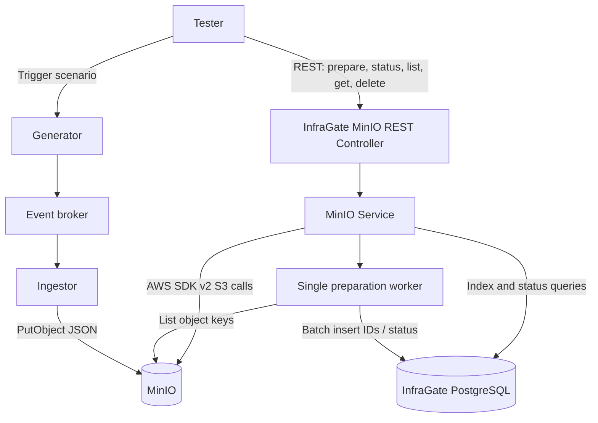
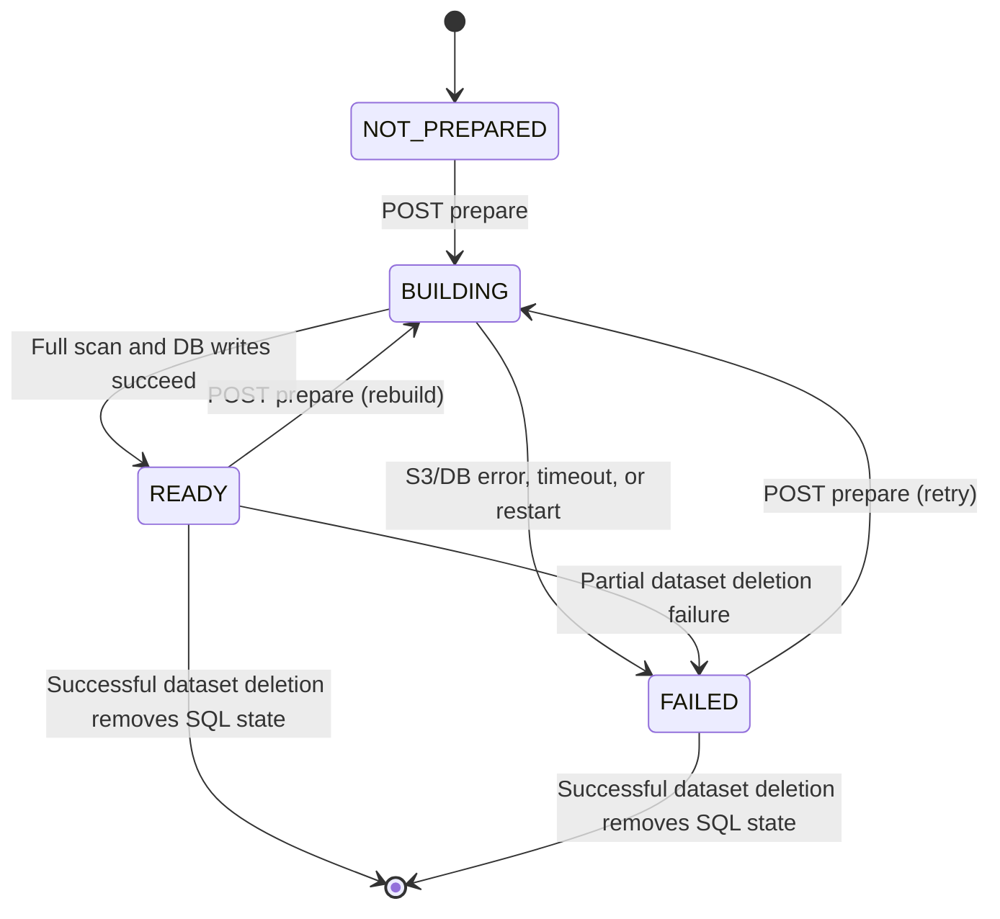

# InfraGate MinIO — Adapter Specification

[← CommerceETLAV Manager](https://github.com/orbartal/commerce-etlav-manager)

[← CommerceETLAV InfraGate](https://github.com/orbartal/commerce-etlav-infra-gateway)

### Shared event-reading contract (approved MVP)

The [main InfraGate README](../README.md) defines the common API standard. Both adapters expose:

- `GET /events/summary/all?index=0&size=100` — ordered event ID strings, including Kafka duplicates.
- `GET /events/details/eventid/{eventId}?index=0&size=10` — paginated normalized full events matching `eventId`.
- Both endpoints require `READY`. Both use `index >= 0`, `1 <= size <= 1000`, `totalCount`, `responseCount`, and `items`.
- `totalCount` is the total matching index rows; `responseCount = items.length`. Missing event IDs return `404 EVENT_NOT_FOUND`.
- Each details item has four top-level fields: `eventId`, `datasetId`, `payload`, `metadata`.
- `payload` is the original Generator event payload. `metadata.kafka` or `metadata.minio` holds adapter-specific data.
- Kafka duplicate `eventId` values are allowed. Duplicate payloads are assumed identical in MVP.
- Only one global Kafka-or-MinIO preparation may run at once. A competing request returns `409 PREPARATION_ALREADY_RUNNING`.
- Invalid JSON or missing/invalid `eventId` or `datasetId` fails preparation. Incomplete indexes are never readable.
- Tester owns the authoritative first E2E scenario; adapter-specific sequences here are summaries.

## Table of Contents

- [1. Context and Goals](#1-context-and-goals)
- [2. MVP Scope and Future Vision](#2-mvp-scope-and-future-vision)
- [3. Technology Stack](#3-technology-stack)
- [4. Architecture and Components](#4-architecture-and-components)
- [5. MinIO Storage Model](#5-minio-storage-model)
- [6. Dataset Preparation and Lifecycle](#6-dataset-preparation-and-lifecycle)
- [7. PostgreSQL Data Model](#7-postgresql-data-model)
- [8. Dataset and Event Pagination](#8-dataset-and-event-pagination)
- [9. MinIO REST API](#9-minio-rest-api)
- [10. Error Handling and Validation](#10-error-handling-and-validation)
- [11. Configuration and Timeouts](#11-configuration-and-timeouts)
- [12. Logging and Recovery](#12-logging-and-recovery)
- [13. Development and Deployment](#13-development-and-deployment)
- [14. Future Extensions](#14-future-extensions)
- [15. References](#15-references)
- [16. Tester Integration — First MVP Test](#16-tester-integration--first-mvp-test)

## Table of Diagrams

| ID | Diagram | Section |
|---|---|---|
| D1 | Component and data flow | [4](#4-architecture-and-components) |
| D2 | Dataset preparation lifecycle | [6](#6-dataset-preparation-and-lifecycle) |
| D3 | Tester integration sequence | [16](#16-tester-integration--first-mvp-test) |

## Table of Tables

| ID | Table | Section |
|---|---|---|
| T1 | MVP versus future scope | 2 |
| T2 | Technology choices | 3 |
| T3 | Storage conventions | 5 |
| T4 | Preparation states | 6 |
| T5 | Database tables | 7 |
| T6 | REST endpoint summary | 9 |
| T7 | Error mapping | 10 |
| T8 | Configuration properties | 11 |
| T9 | First test API interactions | 16 |

## 1. Context and Goals

CommerceETLAV is a locally deployable demonstration of event generation, ingestion, storage, and automated validation. **InfraGate MinIO** is a test-oriented adapter between **Tester** and MinIO object storage. It exposes a small, conventional HTTP/JSON interface and hides S3-specific listing, pagination, deletion, and object-access mechanics.

Tester affects MinIO by two separate paths:

1. **Business-data path:** `Tester → Generator → Kafka → Ingestor → MinIO`. Tester triggers a Generator scenario; Ingestor persists resulting events.
2. **Test-infrastructure path:** `Tester → InfraGate MinIO → MinIO`. Tester lists, inspects, prepares, and cleans stored data through simple REST operations.

Tester **does not directly use the S3 API**, and InfraGate does not generate or ingest business events. The MinIO adapter is logically and code-wise independent of any other InfraGate adapter, while sharing the same repository, process, and deployment in MVP.

### Goals

- Give Tester **simple, standard, synchronous REST calls** for storage inspection and cleanup.
- Provide **zero-based page-index/size pagination** for datasets and events, even though native S3 listing uses continuation tokens.
- Support efficient, repeated event-page reads by **preparing a PostgreSQL-backed dataset snapshot**.
- Preserve the complete JSON event in MinIO; store **only IDs, ordering, and preparation metadata** in PostgreSQL.
- Make dataset deletion a **single synchronous REST operation**, regardless of internal S3 request count.
- Keep the MVP small, locally runnable, and compatible with later alternative indexing strategies or S3 implementations.

### Non-goals

- Writing or transforming business events; bucket creation or deletion; object version-history management.
- Test orchestration, polling schedules, and test retries; these belong to Tester.
- Additional authorization/allowlists for local MVP; future deployments may add them.
- A global transaction spanning MinIO and PostgreSQL.

## 2. MVP Scope and Future Vision

**MVP:** Local MinIO, one configured test bucket (`stores.commerce.events`), multiple datasets within that bucket, one dataset per Generator scenario, and one JSON object per event. InfraGate has a dedicated PostgreSQL Docker container. Dataset preparation scans every matching object key and indexes **every event ID**. Only one preparation may run at a time across the service. Event paging reads PostgreSQL; individual full-event reads access MinIO.

| Capability | MVP | Possible future version |
|---|---|---|
| Storage backend | Local MinIO | AWS S3 or other compatible storage |
| Buckets used by Tester | One | Multiple, possibly by major Tester version |
| Dataset-to-test relationship | One dataset per Generator scenario | More flexible relationships if needed |
| Event index | Every event ID | Sparse checkpoints, e.g. every 100th/1000th key |
| Event pagination | SQL-only | SQL checkpoints plus S3 reads and trimming |
| Concurrent preparations | One globally | Multiple controlled jobs |
| Bucket versioning | Disabled | Evaluate separately |
| Security | Local trusted services | Cloud credentials and resource policies |
| Index persistence | PostgreSQL | Retained or replaced as requirements evolve |

**Scaling distinction:** Sparse indexing can keep InfraGate's *stored index* small even for huge object sets, but an exact count/checkpoint build still needs to enumerate the object keys. Neither a 10 GB object dataset nor a 1 MB index is a guaranteed performance or storage bound; these are future design possibilities, not MVP acceptance criteria.

## 3. Technology Stack

| Component | Choice | Reason |
|---|---|---|
| Language | Java 27 | Align with CommerceETLAV services |
| Framework | Spring Boot 4 / Spring MVC | Conventional REST implementation |
| Build | Maven | Consistent local build |
| Object-storage client | AWS SDK for Java v2 S3 client | Same S3-compatible approach as Ingestor |
| Storage backend | MinIO | Local S3-compatible object storage |
| Database | PostgreSQL, InfraGate-owned container | Persistent event index and job status |
| Database access | Spring JDBC or Spring Data JDBC (implementation choice) | Small, explicit relational model |
| Schema migrations | Flyway (recommended) | Repeatable schema management |
| API docs | OpenAPI / Swagger | Describe endpoints and snapshot caveats |
| Deployment | Docker Compose, coordinated by CommerceETLAV Manager | Local reproducibility |

The REST controller is synchronous from the client's perspective. **Only the `POST /prepare` operation launches a background worker**; it returns immediately, and Tester polls a separate status endpoint. The worker is internal to InfraGate and is not a Tester task.

## 4. Architecture and Components



**Components and responsibilities**

- **REST controller:** Validate request syntax, map domain errors to HTTP, and serialize standard responses.
- **MinIO service:** Encapsulate S3 operations, prefix handling, bucket/dataset listing, event reads, and dataset deletion.
- **Preparation coordinator:** Enforce one global preparation at a time; start a worker; maintain durable status.
- **Preparation worker:** Enumerate event keys, derive event IDs, insert ordered rows in batches, and publish final status.
- **PostgreSQL repository:** Store preparation status, total count, and ordered event identifiers.
- **Tester:** Stop producers/consumers, initiate preparation, await readiness with non-blocking retry logic, validate results, and handle test outcomes.

### Concurrency rules

- Only **one active preparation** may run globally across Kafka and MinIO. A second `POST /prepare` returns `409 PREPARATION_ALREADY_RUNNING`.
- A page request checks readiness and reads its rows within a **consistent PostgreSQL transaction**; it never serves `BUILDING` or `FAILED` data.
- Dataset deletion is rejected while any preparation is active (`409 PREPARATION_ALREADY_RUNNING`), preventing mutation during a scan.
- Tester is responsible for ensuring Generator and Ingestor cannot add or modify events before preparing a dataset. The index is a **point-in-time logical snapshot**, not an S3 transactional snapshot.

## 5. MinIO Storage Model

MinIO supports buckets and object keys, not real nested buckets or transactional folders. A dataset “folder” is the common key prefix `{datasetId}/`.

| Property | MVP convention |
|---|---|
| Default bucket | `stores.commerce.events` |
| Dataset identifier | UUID provided by `GET /api/v1/scenarios/{scenarioId}` on Generator |
| Dataset prefix | `{datasetId}/` |
| Event identifier | UUID from the Generator event |
| Event object key | `{datasetId}/{eventId}.json` |
| Content type | `application/json` |
| Object body | Complete original Generator event in an Ingestor JSON storage envelope, including technical metadata |
| Write operation | Ingestor `PutObject` |
| Repeated delivery | Same deterministic key; overwrite current object |
| Versioning | **Disabled** for MVP test bucket |

Example object:

```text
Bucket: stores.commerce.events
Key:    550e8400-e29b-41d4-a716-446655440000/a7f00000-0000-4000-8000-000000000001.json
```

The exact envelope fields are owned by Ingestor. InfraGate preserves the stored JSON in MinIO, but normalizes its event-details REST response to the shared four-field shape. The exact Ingestor envelope extraction mapping is deferred until cross-repository consistency review. The only required object metadata established by the design is `Content-Type: application/json`; no additional S3 user metadata is assumed.

### Dataset existence

An empty dataset is not a physical directory. If no object keys exist under `{datasetId}/`, that dataset does not appear in MinIO dataset listings. Nevertheless, InfraGate can prepare that dataset and report `READY` with `totalItems: 0`, or delete it idempotently.

### Isolation

Every dataset operation uses the **exact prefix** `{datasetId}/`, including the trailing slash. It must not match similarly named dataset IDs. Only the requested dataset's event objects are deleted; **the bucket and other datasets are never deleted**.

## 6. Dataset Preparation and Lifecycle

### Why prepare?

Native S3 listing does not support numeric random-access page indices or an exact total count. InfraGate performs the expensive key enumeration once, then stores ordered IDs in PostgreSQL. Tester receives simple, efficient indexed pages without knowing the implementation.

### Preparation API behavior

`POST /infragate/api/v1/minio/buckets/{bucket}/datasets/{datasetId}/prepare`

- Returns **HTTP 202 Accepted**, with **no response body**, after successfully scheduling the job.
- Does not wait for MinIO enumeration or PostgreSQL inserts.
- Returns `409 PREPARATION_ALREADY_RUNNING` if any preparation is already active.
- Starts a new build even if the requested dataset was previously `READY` or `FAILED`.

### Preparation sequence

1. Tester disables Generator and Ingestor (or otherwise guarantees the dataset is quiescent).
2. Tester calls `POST /prepare`; InfraGate schedules one background preparation.
3. In **one database transaction**, InfraGate marks the dataset `BUILDING` and **deletes all prior event-index rows** for that dataset.
4. Worker lists all keys under `{datasetId}/` in deterministic lexicographic key order, using S3 continuation tokens.
5. For each valid event object key, worker derives `eventId` and inserts `(bucket, dataset, position, eventId)` in PostgreSQL, using batches.
6. Worker records the final count and sets `READY` **only after every row has been successfully committed**.
7. On any failure, worker records `FAILED` and a diagnostic `message`. Incomplete rows may be cleared; they are never exposed by pagination.
8. Tester polls `GET /status` until `READY` or `FAILED`, with Tester's own asynchronous wait/retry/timeout policy.



### Preparation states

| Status | Meaning | `totalItems` | Event paging |
|---|---|---|---|
| `NOT_PREPARED` | No completed or active preparation | `null` | Reject |
| `BUILDING` | Worker is preparing dataset | `null` | Reject |
| `READY` | Complete index available | Exact integer, including zero | Allow |
| `FAILED` | Preparation interrupted/failed, or prior index invalidated by failed deletion | `null` | Reject |

Status endpoint example:

```json
{
  "datasetId": "550e8400-e29b-41d4-a716-446655440000",
  "status": "READY",
  "totalItems": 1000,
  "message": "Dataset preparation completed successfully."
}
```

`message` is optional and can describe any state. **There is no `isPrepared` flag**: readiness is represented solely by `status == READY`.

### Timeouts and restarts

Preparation is asynchronous and has a **separate configurable worker timeout**, initially 30 seconds for MVP. The ordinary HTTP request timeout applies to `POST /prepare` and `GET /status`, not to the entire background scan. A worker timeout sets `FAILED`; the status message explains the cause. On service startup, any persisted `BUILDING` dataset is marked `FAILED` and its incomplete index rows removed. No automatic retry is started. Tester may explicitly call `POST /prepare` again.

### Snapshot constraint

Tester must stop Generator and Ingestor before preparation
and keep the dataset unchanged until validation completes.

InfraGate does not continuously monitor MinIO for external changes.

For MVP, InfraGate detects changes only when they are observable
during its own operations, such as a missing indexed object
during event-details retrieval.

When InfraGate detects an unexpected change:
- Mark the affected preparation as FAILED.
- Reject further event reads.
- Return 409 INDEX_OUT_OF_DATE for the detecting request.
- Tester fails the test.

Undetected external changes are outside the MVP guarantees.
Tester is responsible for ensuring dataset stability.


## 7. PostgreSQL Data Model

PostgreSQL belongs to InfraGate MinIO and runs in a dedicated Docker container. It stores **no event JSON**.

### Dataset preparation table

Suggested table `minio_dataset_preparation`:

| Column | Type | Notes |
|---|---|---|
| `bucket_name` | text | Part of primary key |
| `dataset_id` | uuid | Part of primary key |
| `status` | varchar | `BUILDING`, `READY`, `FAILED` |
| `total_events` | bigint nullable | Populated only for `READY` |
| `message` | text nullable | Human-readable detail |
| `indexed_at` | timestamptz nullable | Last successful preparation time |
| `updated_at` | timestamptz | Last status change |

`NOT_PREPARED` is **derived from absence of a preparation row**; it need not be persisted.

### Event index table

Suggested table `minio_event_index`:

| Column | Type | Notes |
|---|---|---|
| `bucket_name` | text | Dataset identity |
| `dataset_id` | uuid | Dataset identity |
| `position` | bigint | Zero-based order within dataset |
| `event_id` | uuid | Derived from `{eventId}.json` |

Suggested primary key: `(bucket_name, dataset_id, position)`; optional uniqueness constraint on `(bucket_name, dataset_id, event_id)`. Consider a foreign key to the preparation row with cascading cleanup.

### Transactions

- At rebuild start: atomically set `BUILDING` and delete old event rows.
- During build: insert rows in batches; they remain inaccessible while status is `BUILDING`.
- At successful completion: atomically record `total_events` and `READY` after inserts finish.
- During pagination: check `READY`, obtain `total_events`, and select rows under a consistent database snapshot.
- After successful MinIO dataset deletion and verification: delete SQL index rows and preparation metadata.
- On partial MinIO deletion failure: retain SQL rows but set `FAILED`, preventing stale pagination.

### Example SQL page query

```sql
SELECT event_id
FROM minio_event_index
WHERE bucket_name = :bucket
  AND dataset_id = :datasetId
ORDER BY position
LIMIT :size OFFSET :offset;
```

For MVP, `offset = index * size` and all event IDs are stored. The service must validate multiplication/offset bounds. The table's ordering is **lexicographic by object key**, not event creation time or Generator sequence number.

## 8. Dataset and Event Pagination

### 8.1 Shared event pagination

Both event-reading APIs require a prepared `READY` index and return the shared envelope:

```json
{"index":0,"size":100,"totalCount":2,"responseCount":2,"items":["event-A","event-B"]}
```

- `index`: zero-based, default 0.
- Summary `size` default 100; details `size` default 10; maximum 1000 for both.
- `totalCount`: total matching indexed events; `responseCount`: exact current `items.length`.
- Summary `items`: event IDs only. Details `items`: normalized complete events.
- Page beyond end returns `200`, empty `items`, and `responseCount: 0`.
- Missing `eventId` returns `404 EVENT_NOT_FOUND`.
- A dataset with no objects can be prepared `READY` with zero events.

Summary order is lexicographic by object key, not event creation time. MinIO normally has one matching object per `eventId`, but details use the same paging contract as Kafka. All event IDs and positions are indexed in PostgreSQL; full JSON is fetched from MinIO only for details.

### 8.2 Dataset listing

The separate dataset-listing endpoint enumerates prefixes directly from MinIO and does **not** require preparation. It retains zero-based paging with default size 100 and maximum 1000. Its response uses `totalCount` and `responseCount` for consistency with the shared page envelope.

### 8.3 Stability

Tester must prevent writes/deletes during preparation and validation. MinIO list operations are not transactional snapshots. A detected unexpected change invalidates the affected prepared index and fails the test; no partial success is allowed.

## 9. MinIO REST API

Base path:

```text
/infragate/api/v1/minio
```

### Endpoint summary

| Method | Path (relative to base) | Purpose | Data source |
|---|---|---|---|
| `GET` | `/buckets` | List all accessible bucket names | MinIO |
| `GET` | `/buckets/{bucket}/datasets` | Page dataset IDs and exact count | MinIO |
| `POST` | `/buckets/{bucket}/datasets/{datasetId}/prepare` | Start asynchronous dataset preparation | Worker / MinIO / PostgreSQL |
| `GET` | `/buckets/{bucket}/datasets/{datasetId}/status` | Read preparation status | PostgreSQL |
| `GET` | `/buckets/{bucket}/datasets/{datasetId}/events/summary/all` | Page event IDs and exact count | PostgreSQL |
| `GET` | `/buckets/{bucket}/datasets/{datasetId}/events/details/eventid/{eventId}` | Page normalized full events by ID | PostgreSQL / MinIO |
| `DELETE` | `/buckets/{bucket}/datasets/{datasetId}` | Delete dataset, verify empty, then remove SQL index | MinIO / PostgreSQL |

All seven are standard synchronous HTTP calls. `POST /prepare` starts asynchronous **server-side work**, but its own HTTP response is immediate.

### 9.1 List buckets

Lists **all buckets visible to the configured S3 credentials**, not only the default test bucket. No pagination or extra bucket metadata is required in MVP.

```http
GET /infragate/api/v1/minio/buckets
```

```json
{
  "buckets": ["stores.commerce.events"]
}
```

### 9.2 List datasets in one bucket

```http
GET /infragate/api/v1/minio/buckets/stores.commerce.events/datasets?index=0&size=100
```

```json
{
  "index": 0,
  "size": 100,
  "totalCount": 2,
  "responseCount": 2,
  "items": [
    "550e8400-e29b-41d4-a716-446655440000",
    "660e8400-e29b-41d4-a716-446655440000"
  ]
}
```

Lists prefixes directly from MinIO; does not read SQL and does not require `prepare`.

### 9.3 Trigger dataset prepare

```http
POST /infragate/api/v1/minio/buckets/stores.commerce.events/datasets/550e8400-e29b-41d4-a716-446655440000/prepare
```

Success: **`202 Accepted` with an empty body**. The worker begins a full rebuild. Concurrent preparation is rejected with `409 PREPARATION_ALREADY_RUNNING`.

### 9.4 Get one dataset status

```http
GET /infragate/api/v1/minio/buckets/stores.commerce.events/datasets/550e8400-e29b-41d4-a716-446655440000/status
```

During preparation:

```json
{
  "datasetId": "550e8400-e29b-41d4-a716-446655440000",
  "status": "BUILDING",
  "totalItems": null,
  "message": "Dataset preparation is running."
}
```

After completion:

```json
{
  "datasetId": "550e8400-e29b-41d4-a716-446655440000",
  "status": "READY",
  "totalItems": 1000,
  "message": "Dataset preparation completed successfully."
}
```

Failed preparation:

```json
{
  "datasetId": "550e8400-e29b-41d4-a716-446655440000",
  "status": "FAILED",
  "totalItems": null,
  "message": "MinIO connection timed out during preparation."
}
```

Never-prepared datasets return `NOT_PREPARED` and `totalItems: null`. `message` is optional in all states.

### 9.5 Get event summaries with paging

```http
GET /infragate/api/v1/minio/buckets/stores.commerce.events/datasets/550e8400-e29b-41d4-a716-446655440000/events/summary/all?index=0&size=100
```

```json
{
  "index": 0,
  "size": 100,
  "totalCount": 2,
  "responseCount": 2,
  "items": ["a7f00000-0000-4000-8000-000000000001", "a7f00000-0000-4000-8000-000000000002"]
}
```

Returns IDs from the prepared PostgreSQL index only. Requires `READY`.

### 9.6 Get paginated full event details by eventId

```http
GET /infragate/api/v1/minio/buckets/stores.commerce.events/datasets/550e8400-e29b-41d4-a716-446655440000/events/details/eventid/a7f00000-0000-4000-8000-000000000001?index=0&size=10
```

```json
{
  "index": 0,
  "size": 10,
  "totalCount": 1,
  "responseCount": 1,
  "items": [
    {
      "eventId": "a7f00000-0000-4000-8000-000000000001",
      "datasetId": "550e8400-e29b-41d4-a716-446655440000",
      "payload": {"example": "original Generator event payload"},
      "metadata": {"minio": {"bucket": "stores.commerce.events", "objectKey": "550e8400-e29b-41d4-a716-446655440000/a7f00000-0000-4000-8000-000000000001.json"}}
    }
  ]
}
```

Requires `READY`. SQL locates matching IDs, and MinIO supplies the original stored object. InfraGate maps the Ingestor envelope into the shared four-field event shape without changing the object in storage. The exact envelope field mapping remains deferred to the cross-repository consistency review. Unknown IDs return `404 EVENT_NOT_FOUND`.

### 9.7 DELETE dataset by datasetId

```http
DELETE /infragate/api/v1/minio/buckets/stores.commerce.events/datasets/550e8400-e29b-41d4-a716-446655440000
```

Success:

```json
{
  "datasetId": "550e8400-e29b-41d4-a716-446655440000",
  "deletedObjects": 1000,
  "isDatasetEmpty": true
}
```

**Deletion algorithm:**

1. Reject if any preparation is running.
2. List keys under the exact dataset prefix `{datasetId}/`.
3. Delete objects in S3 `DeleteObjects` batches (up to 1,000 keys per batch), continuing until all matching keys have been processed.
4. Inspect **per-object delete results**: an HTTP-success response may still contain individual failures. Any failure causes the dataset operation to fail; log the confirmed deletion count. No automatic retry in MVP.
5. After deletion, perform **an additional MinIO list** to verify the prefix is empty.
6. Only after verified success, remove that dataset's PostgreSQL index rows and preparation metadata.
7. Return the single success response shown above.

Deletion is **idempotent**: an absent/already-empty dataset returns `deletedObjects: 0`, `isDatasetEmpty: true`. The bucket is never deleted. With versioning disabled, ordinary object deletion permanently removes the current objects.

If deletion partially succeeds and then fails, **retain** SQL rows but set preparation status to `FAILED`, so event paging cannot serve stale IDs. Tester fails Setup. A later explicit DELETE can remove remaining objects. `deletedObjects` in the success response counts objects removed by that call, not historical deletions.

### REST contract conventions

- Request/response IDs use UUID string representations.
- Use UTC ISO-8601 timestamps in errors and logs.
- Return JSON for all structured success/error responses; `POST /prepare` has no body.
- Use explicit query validation and consistent status codes.
- Document each endpoint, examples, and consistency constraints in Swagger/OpenAPI.

## 10. Error Handling and Validation

Standard error body:

```json
{
  "code": "BUCKET_NOT_FOUND",
  "message": "Bucket stores.commerce.events does not exist.",
  "timestamp": "2026-11-07T15:00:00Z"
}
```

| HTTP | Code | Condition |
|---|---|---|
| 400 | `INVALID_REQUEST` | Invalid UUID, bucket/path input, page index/size, or malformed request |
| 404 | `BUCKET_NOT_FOUND` | Requested bucket does not exist |
| 404 | `EVENT_NOT_FOUND` | Event key does not exist |
| 409 | `RESOURCE_NOT_PREPARED` | Event paging requested when status is not `READY` |
| 409 | `PREPARATION_ALREADY_RUNNING` | Prepare or delete conflicts with active preparation |
| 409 | `INDEX_OUT_OF_DATE` | Detected unexpected change invalidates the prepared index |
| 500 | `INTERNAL_ERROR` | Unexpected InfraGate or database error |
| 503 | `SERVICE_UNAVAILABLE` | MinIO/S3 service unreachable |
| 504 | `SERVICE_TIMEOUT` | S3 operation or deletion request exceeds configured timeout |

**Preparation worker errors:** `POST /prepare` normally already returned `202`; later worker failures are persisted as `FAILED` with `message` and reported by `GET /status`, rather than retroactively changing the POST response.

**Partial deletion errors:** Map S3 errors to the appropriate standard error (`SERVICE_UNAVAILABLE`, `SERVICE_TIMEOUT`, or `INTERNAL_ERROR`); include a useful non-sensitive message and log confirmed deletions. An individual S3 batch error must never produce a successful dataset deletion response.

**Empty cases:** An empty dataset list, empty event page, nonexistent dataset deletion, and preparation of an empty dataset are normal successful operations. An event by ID that does not exist returns `404 EVENT_NOT_FOUND`.

**Input checks:** Validate UUID formatting for dataset/event IDs, page bounds, bucket presence, and arithmetic overflow for `index * size`. Do not interpret client IDs as arbitrary object paths.

## 11. Configuration and Timeouts

Illustrative Spring configuration (property names are proposed for implementation):

```yaml
infragate:
  minio:
    endpoint: ${MINIO_ENDPOINT:http://minio:9000}
    region: ${MINIO_REGION:us-east-1}
    default-bucket: ${MINIO_BUCKET:stores.commerce.events}
    path-style-access: true
    deletion-timeout-seconds: 30
    preparation-timeout-seconds: 30
    page-size-default: 100
    page-size-max: 1000
    max-concurrent-preparations: 1
    index-insert-batch-size: 500

spring:
  datasource:
    url: ${INFRAGATE_DB_URL:jdbc:postgresql://infragate-postgres:5432/infragate}
    username: ${INFRAGATE_DB_USER:infragate}
    password: ${INFRAGATE_DB_PASSWORD}
```

| Property | MVP value | Purpose |
|---|---|---|
| MinIO endpoint | `http://minio:9000` | Local S3-compatible service |
| Default bucket | `stores.commerce.events` | Test's conventional bucket; not an API allowlist |
| S3 credentials | Environment variables / SDK credential provider | Access MinIO |
| PostgreSQL connection | Dedicated InfraGate DB | Persistent index/status |
| Default/max page size | `100` / `1000` | REST pagination |
| Deletion timeout | 30 seconds | Complete synchronous DELETE operation |
| Preparation timeout | 30 seconds | Background worker deadline, independently configurable |
| Concurrent preparations | 1 | Global MVP restriction |
| SQL insert batch size | e.g. 500 | Internal performance tuning |

**Important timeout distinction:** Tester's asynchronous 30-second wait/retry is its own test-policy setting; it is **not** InfraGate's HTTP timeout or background preparation timeout. In future large-data tests, preparation may take much longer and its worker timeout can be increased independently.

Bucket listing returns **all buckets accessible to the configured credentials**, even though the default test uses one. No additional MVP bucket allowlist is imposed. A future AWS S3 deployment can introduce tighter permissions and configuration.

## 12. Logging and Recovery

### Logging

Log structured information at significant lifecycle points:

- Preparation accepted/rejected, bucket/dataset, start time, status changes, duration, total indexed IDs.
- Preparation failure reason, batch progress summary, and final `FAILED` status.
- Dataset deletion requested, batch outcomes, **confirmed number deleted**, verification result, and SQL cleanup.
- S3 timeout/unavailability and database failures.
- InfraGate startup reconciliation of interrupted preparation records.

Do not log full JSON event payloads by default. Avoid logging credentials or other secrets.

### Startup recovery

1. Connect to PostgreSQL and perform required schema migrations.
2. Find preparation records left in `BUILDING` after a crash/restart.
3. Mark them `FAILED` and remove incomplete event-index rows.
4. Release/reset the in-process preparation guard.
5. Start accepting REST requests.

A previously `READY` index remains available across restarts unless explicitly rebuilt, invalidated, or deleted. A failed preparation is not automatically retried.

### Partial deletion recovery

If any MinIO delete batch fails or post-delete verification finds remaining objects, the API returns an error. Preserve the SQL event rows but mark the preparation `FAILED`; this prevents stale paging. A subsequent explicit dataset DELETE retries cleanup at the dataset level (without automatic internal retry) and removes SQL records only after verified empty.

### Consistency and limitations

- There is **no distributed transaction** between S3 and PostgreSQL.
- Prepared indices are snapshots valid only while the corresponding MinIO dataset remains unchanged.
- S3 object listing may require multiple requests; a concurrent writer can change results mid-scan.
- Database failure after successful MinIO deletion is an exceptional recovery case: report failure and reconcile/remove stale SQL records on a subsequent cleanup or administrative recovery; never claim atomicity across systems.

## 13. Development and Deployment

### Local service dependencies

- InfraGate MinIO application container.
- Dedicated InfraGate PostgreSQL container.
- Local MinIO container with a bucket named `stores.commerce.events`.
- Generator and Ingestor for end-to-end integration tests (not needed for every unit test).

The Manager coordinates Docker Compose startup and service dependencies. MinIO bucket creation and versioning configuration are **infrastructure responsibilities**, not InfraGate REST operations. Ensure bucket versioning is disabled in MVP.

### Suggested startup order

1. Start PostgreSQL and MinIO; wait for health checks.
2. Provision `stores.commerce.events` and verify versioning is disabled.
3. Start InfraGate; apply DB migrations and reconcile interrupted preparations.
4. Start dependent Tester/Generator/Ingestor services as required by the test scenario.

### Build and run

Illustrative Maven commands (adjust module names and configuration to the actual repository):

```bash
mvn clean verify
mvn spring-boot:run
```

Use environment variables for MinIO credentials and database password. Do not commit secrets.

### Suggested tests

- **Unit:** UUID/pagination validation, prefix matching, key parsing, status transitions, SQL paging, conflict handling.
- **Integration:** S3-compatible bucket listing, dataset prefix discovery, full JSON retrieval, batch deletion and verification, prepared paging, empty dataset, rebuild, and restart recovery.
- **Failure injection:** MinIO timeout, per-object delete errors, partial deletion, database failure, and interrupted preparation.
- **Contract:** Swagger/OpenAPI examples and HTTP status/error bodies.

### Acceptance criteria

- All seven endpoints behave as documented.
- One preparation builds an exact index for a stable dataset; event page requests do not query MinIO.
- Event IDs returned by pagination match the prepared lexicographic object-key order.
- Full-event GET returns the shared normalized four-field event object; the underlying MinIO object remains unmodified.
- Deletion affects only the selected dataset, verifies empty, and clears SQL index only after successful verification.
- Incomplete preparation and partial deletion never expose `READY` paging.
- Restart marks interrupted preparation `FAILED` while retaining previously completed indices.

## 14. Future Extensions

These are **not MVP requirements**:

1. **Sparse SQL index:** Store checkpoints every N events (e.g. 100 or 1,000), instead of all IDs. To retrieve a page, find the nearest stored key/position, use S3 `StartAfter` or a backend-specific continuation mechanism, scan forward, trim leading/trailing extra keys, and return the exact page. This can reduce SQL storage greatly, but introduces extra storage reads and requires compatibility checks for alternative S3 bucket types.
2. **Very large datasets:** Increase preparation timeout, add progress metrics and/or scalable workers; avoid premature complexity in MVP.
3. **Multiple concurrent preparations:** Per-dataset coordination, job quotas, and resource controls.
4. **Multiple buckets and AWS S3:** Cloud credentials, IAM policies, optional bucket allowlists, and storage-specific adapters where necessary.
5. **Dataset-level quiescence:** Stop only events for the target task/dataset instead of globally disabling Generator and Ingestor.
6. **Alternative verification:** Aggregate counts, checksums, sampled events, or other validation methods rather than reading all IDs for huge datasets.
7. **Object versioning:** Only if a later requirement explicitly calls for historical versions and corresponding cleanup semantics.

The public REST vocabulary remains **`prepare`**, **`status`**, and **`events`**, not implementation-specific `index` endpoints. Internals may change without changing Tester's contract.

## 15. References

### CommerceETLAV repositories

- [Ingestor](https://github.com/orbartal/commerce-etlav-ingestor) — MinIO integration, deterministic object key, and JSON storage envelope.
- [Generator](https://github.com/orbartal/commerce-etlav-generator) — scenario definitions and fixed dataset UUIDs.
- [Tester](https://github.com/orbartal/commerce-etlav-tester) — test orchestration, non-blocking waits, retries, and reports.
- [Manager](https://github.com/orbartal/commerce-etlav-manager) — local service coordination.
- [InfraGate](https://github.com/orbartal/commerce-etlav-infra-gateway) — infrastructure adapter repository.

### Technology references

- [Amazon S3 ListObjectsV2 API](https://docs.aws.amazon.com/AmazonS3/latest/API/API_ListObjectsV2.html) — prefix listing, continuation tokens, delimiter, `MaxKeys`.
- [Amazon S3 DeleteObjects API](https://docs.aws.amazon.com/AmazonS3/latest/API/API_DeleteObjects.html) — batched deletion and per-object errors.
- [AWS SDK for Java 2.x: S3 examples](https://docs.aws.amazon.com/sdk-for-java/latest/developer-guide/java_s3_code_examples.html).
- [MinIO documentation](https://min.io/docs/minio/linux/index.html) — S3-compatible storage and administration.
- [PostgreSQL documentation](https://www.postgresql.org/docs/) — persistence and transactional reads.
- [Spring Boot documentation](https://docs.spring.io/spring-boot/index.html).

The Ingestor object format and Generator scenario API are upstream contracts. Confirm actual deployed endpoint prefixes and JSON fields against their implementations during integration; examples here describe the approved InfraGate design, not evidence of deployed code.

## 16. Tester Integration

**Authority:** The Tester repository README owns the exact first-test workflow. This section summarizes MinIO-specific integration only. — First MVP Test

### Objective

Validate that one Generator scenario's events are processed by Ingestor and persisted in MinIO as expected. Each Generator scenario has a **fixed dataset UUID** obtainable from `GET /api/v1/scenarios/{scenarioId}`. The first MVP scenario is expected to generate a manageable number of events (approximately 1,000 in the current plan).

### Responsibilities

- **Tester:** Orchestrates Setup → Scenario → Validation → Teardown, handles async waits/retries, and produces the final report.
- **Generator:** Publishes events for the chosen scenario/dataset.
- **Ingestor:** Processes events and writes `{datasetId}/{eventId}.json` to MinIO.
- **InfraGate MinIO:** Cleans the dataset, prepares the event-ID snapshot, serves pages and full JSON, and reports status.

### End-to-end sequence

```mermaid
sequenceDiagram
    participant T as Tester
    participant G as Generator
    participant I as Ingestor
    participant F as InfraGate MinIO
    participant M as MinIO
    participant P as PostgreSQL

    T->>G: GET scenario details (datasetId)
    T->>G: Disable generation / ensure quiet
    T->>I: Disable processing
    T->>F: DELETE dataset
    F->>M: List + delete dataset objects in batches
    F->>M: Verify dataset prefix empty
    F->>P: Remove dataset index after verified deletion
    F-->>T: deletedObjects, isDatasetEmpty=true
    T->>I: Enable processing
    T->>G: Trigger scenario
    G-->>I: Events flow through broker
    I->>M: PutObject per event
    T->>G: Disable generation / ensure quiet
    T->>I: Disable processing after drain
    T->>F: POST dataset/prepare
    F-->>T: 202 Accepted
    F->>P: BUILDING + clear old rows
    F->>M: List all dataset object keys
    F->>P: Batch insert event IDs; mark READY
    loop Tester non-blocking wait/retry
        T->>F: GET dataset/status
        F-->>T: BUILDING or READY or FAILED
    end
    T->>F: GET dataset/events/summary/all?index=0&size=100
    F->>P: Read indexed page and totalCount
    F-->>T: Event IDs + totalCount / responseCount
    T->>F: GET dataset/events/details/eventid/{eventId}?index=0&size=10
    F->>M: GetObject JSON
    F-->>T: Normalized event details
    Note over T,M: Teardown preserves stored data for debugging
```

The exact stop/drain sequencing must guarantee **no in-flight Ingestor writes** before preparation. Simply disabling new consumption is not sufficient if existing writes are still completing. Tester should wait for the relevant service to report quiescence before `POST /prepare`.

### First test API interactions

| Phase | Call | Expected outcome |
|---|---|---|
| Setup | Generator scenario details | Obtain fixed `datasetId` |
| Setup | Disable Generator/Ingestor as appropriate | No concurrent writes during cleanup |
| Setup | `DELETE /buckets/{bucket}/datasets/{datasetId}` | `isDatasetEmpty: true` |
| Scenario | Trigger Generator scenario | Events published and ingested |
| Wait | Tester awaits completion/drain | No more writes to target dataset |
| Prepare | `POST /buckets/{bucket}/datasets/{datasetId}/prepare` | HTTP `202`, empty body |
| Wait | Poll `GET /buckets/{bucket}/datasets/{datasetId}/status` | Eventually `READY`; `FAILED` fails test |
| Validate | `GET /buckets/{bucket}/datasets/{datasetId}/events/summary/all?index=0&size=100` | IDs and exact `totalCount` / `responseCount` |
| Validate | Further event pages as needed | Complete set of expected event IDs |
| Validate | `GET /buckets/{bucket}/datasets/{datasetId}/events/details/eventid/{eventId}?index=0&size=10` | Normalized Generator payload matches expected event |
| Teardown | Disable processing, preserve evidence | No automatic MinIO dataset deletion |

### Assertions

- Setup leaves the target dataset empty without touching other datasets.
- Generator scenario and MinIO dataset use the same fixed `datasetId`.
- After processing finishes, preparation reaches `READY` with the expected count.
- Paginated IDs are complete, unique, and consistent with expected event IDs.
- Sampled or all full-event JSON envelopes (per Tester scenario rules) preserve the original business fields and technical metadata.
- Any preparation failure, deletion failure, count mismatch, missing event, or malformed envelope causes Tester to fail the relevant step and record evidence.

### Waiting and failure policy

Tester owns **non-blocking `await`/`until`/retry** behavior. For example, it can poll every few seconds for up to 30 seconds, but the exact schedule is a Tester scenario policy, not InfraGate's internal preparation deadline. A `FAILED` preparation is terminal for that attempt. An event-page request before `READY` returns `409 RESOURCE_NOT_PREPARED`; Tester should normally poll status instead of blindly retrying pages.

### Cleanup policy

**Do not delete test data automatically at the end of a successful or failed test.** Preserve it for investigation. The next test's Setup removes the target dataset using the single InfraGate DELETE endpoint. InfraGate never deletes the entire MinIO bucket or unrelated datasets.

---

**Document identifier:** InfraGate MinIO README v1.  
**Design baseline:** Seven REST endpoints; PostgreSQL-backed full event-ID index; asynchronous preparation with status polling; synchronous verified dataset deletion; local MinIO bucket with versioning disabled.
